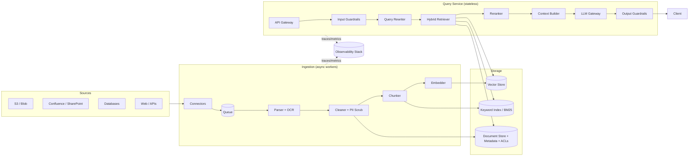

# Ragforge — Production-Grade Retrieval-Augmented Generation

> A reference implementation and operating guide for building, evaluating, deploying, and running Retrieval-Augmented Generation (RAG) systems in production.

[](#)
[](#)
[](#license)

---

## Table of Contents

1. [Overview](#overview)
2. [Key Features](#key-features)
3. [Architecture](#architecture)
4. [Repository Layout](#repository-layout)
5. [Quick Start](#quick-start)
6. [Configuration](#configuration)
7. [API Reference](#api-reference)
8. [Deployment](#deployment)
9. [Troubleshooting](#troubleshooting)
10. [Contributing](#contributing)
11. [License](#license)

Design requirements and detailed specifications (ingestion, retrieval, generation, evaluation, observability, security, operations, readiness checklist) live in the [Product Requirements Document](docs/PRD.md).

---

## Overview

Ragforge answers natural-language questions over your private data by retrieving relevant passages from a curated knowledge base and grounding a Large Language Model's (LLM) response in those passages, with citations.

A demo RAG system is easy to build. A **production** RAG system must also be:

| Requirement | What it means here |
|---|---|
| **Accurate** | Answers are grounded in sources; hallucinations are measured and gated in CI |
| **Fresh** | New and changed documents are indexed incrementally within minutes |
| **Secure** | Users only retrieve documents they are authorized to see |
| **Observable** | Every request is traced end-to-end: query → retrieval → rerank → generation |
| **Scalable** | Stateless services scale horizontally; the vector store scales independently |
| **Cost-aware** | Caching, model routing, and token budgets keep unit cost predictable |
| **Evaluated** | Every change to prompts, chunking, models, or retrieval is benchmarked |

---

## Key Features

- **Multi-format ingestion** — PDF, DOCX, HTML, Markdown, Confluence, SharePoint, Google Drive, S3, databases
- **Layout-aware parsing** — tables, headings, and lists preserved; OCR fallback for scanned documents
- **Configurable chunking** — recursive, semantic, and structure-aware (heading-based) strategies
- **Hybrid retrieval** — dense vectors + BM25 sparse search fused with Reciprocal Rank Fusion (RRF)
- **Cross-encoder reranking** — improves precision of the top-k context window
- **Query understanding** — rewriting, multi-query expansion, HyDE, and conversational condensation
- **Grounded generation** — mandatory inline citations, "I don't know" fallback, streaming responses
- **Document-level access control** — ACL filters enforced at query time, not post-hoc
- **Guardrails** — prompt-injection detection, PII redaction, output moderation
- **Evaluation harness** — golden datasets, retrieval metrics, LLM-as-judge, regression gates in CI
- **Full observability** — OpenTelemetry traces, Prometheus metrics, structured logs, user feedback loop
- **Pluggable providers** — swap LLMs, embedding models, and vector stores via configuration

---

## Architecture



---

## Repository Layout

```
ragforge/
├── apps/
│   ├── api/                  # Query service (FastAPI)
│   ├── ingestion/            # Ingestion workers
│   └── admin/                # Index management & feedback review UI
├── ragforge/
│   ├── connectors/           # Source connectors (S3, Confluence, ...)
│   ├── parsing/              # Parsers, OCR, table extraction
│   ├── chunking/             # Chunking strategies
│   ├── embeddings/           # Embedding provider adapters
│   ├── retrieval/            # Dense, sparse, hybrid, filters, fusion
│   ├── reranking/            # Reranker adapters
│   ├── generation/           # Prompt templates, context builder, LLM gateway
│   ├── guardrails/           # Injection detection, PII, moderation
│   ├── security/             # ACL resolution, tenant isolation
│   ├── cache/                # Exact + semantic caching
│   └── observability/        # Tracing, metrics, logging helpers
├── prompts/                  # Versioned prompt templates (YAML)
├── evals/
│   ├── datasets/             # Golden Q&A sets (versioned)
│   ├── metrics/              # Retrieval + generation metrics
│   └── run_eval.py           # Evaluation entrypoint
├── deploy/
│   ├── docker/               # Dockerfiles
│   ├── helm/                 # Helm chart
│   ├── terraform/            # Cloud infrastructure
│   └── grafana/              # Dashboards as code
├── tests/
│   ├── unit/
│   ├── integration/
│   └── load/                 # k6 / Locust scripts
├── configs/
│   ├── base.yaml
│   ├── dev.yaml
│   ├── staging.yaml
│   └── prod.yaml
├── docker-compose.yml
├── Makefile
├── pyproject.toml
└── README.md
```

---

## Quick Start

### Prerequisites

- Python 3.11+
- Docker and Docker Compose
- `make`
- An API key for your chosen LLM and embedding provider (or a local model server)

### 1. Clone and install

```bash
git clone https://github.com/your-org/ragforge.git
cd ragforge
make install          # creates venv, installs deps, sets up pre-commit hooks
cp .env.example .env  # then fill in secrets
```

### 2. Start local infrastructure

```bash
make up               # Postgres+pgvector, OpenSearch, Redis, Kafka, Jaeger, Grafana
```

### 3. Ingest sample documents

```bash
make ingest SOURCE=./samples/docs
```

### 4. Run the API

```bash
make api              # http://localhost:8000  (docs at /docs)
```

### 5. Ask a question

```bash
curl -s http://localhost:8000/v1/query \
  -H "Authorization: Bearer $DEV_TOKEN" \
  -H "Content-Type: application/json" \
  -d '{"query": "What is our refund policy for annual plans?"}' | jq
```

### 6. Run the evaluation suite

```bash
make eval DATASET=evals/datasets/golden_v3.jsonl
```

### Common Make targets

| Command | Description |
|---|---|
| `make install` | Install dependencies and hooks |
| `make up` / `make down` | Start / stop local infrastructure |
| `make api` | Run query API with hot reload |
| `make worker` | Run ingestion worker |
| `make ingest SOURCE=...` | Ingest a local folder or connector |
| `make test` | Unit + integration tests |
| `make eval` | Offline evaluation against golden set |
| `make lint` | Ruff, mypy, prompt linting |
| `make load-test` | Run load tests against local API |
| `make build` | Build production Docker images |

---

## Configuration

Configuration is layered: `configs/base.yaml` → `configs/<env>.yaml` → environment variables. Secrets **only** come from environment variables or a secrets manager — never from YAML files.

### Example `configs/base.yaml`

```yaml
ingestion:
  chunking:
    strategy: structure_aware     # recursive | semantic | structure_aware
    chunk_size_tokens: 512
    chunk_overlap_tokens: 64
    min_chunk_tokens: 50
  embeddings:
    provider: openai_compatible
    model: text-embedding-model
    dimensions: 1024
    batch_size: 64
  dedup:
    enabled: true
    method: minhash
    threshold: 0.9

retrieval:
  mode: hybrid                    # dense | sparse | hybrid
  dense_top_k: 50
  sparse_top_k: 50
  fusion: rrf
  rrf_k: 60
  reranker:
    enabled: true
    model: cross-encoder-reranker
    top_n: 8
  min_relevance_score: 0.35
  query_rewrite:
    enabled: true
    multi_query: 3

generation:
  model: primary-llm
  fallback_model: secondary-llm
  temperature: 0.1
  max_context_tokens: 6000
  max_output_tokens: 800
  prompt_template: prompts/answer_with_citations.v4.yaml
  require_citations: true
  stream: true

cache:
  exact_ttl_seconds: 3600
  semantic:
    enabled: true
    similarity_threshold: 0.95

guardrails:
  prompt_injection: true
  pii_redaction: true
  output_moderation: true
```

### Environment variables

| Variable | Required | Description |
|---|---|---|
| `RAG_ENV` | yes | `dev`, `staging`, or `prod` |
| `LLM_API_KEY` | yes | LLM provider API key |
| `EMBEDDING_API_KEY` | yes | Embedding provider key (may equal `LLM_API_KEY`) |
| `DATABASE_URL` | yes | Postgres / document store DSN |
| `VECTOR_STORE_URL` | yes | Vector database endpoint |
| `SEARCH_URL` | yes | Keyword index endpoint |
| `REDIS_URL` | yes | Cache and rate-limit store |
| `KAFKA_BROKERS` | yes | Ingestion queue brokers |
| `OIDC_ISSUER` / `OIDC_AUDIENCE` | yes | JWT validation |
| `OTEL_EXPORTER_OTLP_ENDPOINT` | no | Tracing collector |
| `LOG_LEVEL` | no | Default `INFO` |

---

## API Reference

Interactive OpenAPI docs are served at `/docs`.

### `POST /v1/query`

```json
{
  "query": "What is our refund policy for annual plans?",
  "conversation_id": "c_8f2a",
  "filters": { "doc_type": ["policy"], "updated_after": "2025-01-01" },
  "stream": false,
  "top_k": 8
}
```

**Response**

```json
{
  "answer": "Annual plans can be refunded pro rata within 30 days of renewal [doc:812#chunk:3].",
  "citations": [
    {
      "id": "doc:812#chunk:3",
      "title": "Billing & Refund Policy",
      "url": "https://wiki.example.com/billing/refunds",
      "score": 0.87
    }
  ],
  "trace_id": "4bf92f3577b34da6a3ce929d0e0e4736",
  "usage": { "prompt_tokens": 2310, "completion_tokens": 64 },
  "latency_ms": 1840
}
```

### Other endpoints

| Method | Path | Description |
|---|---|---|
| `POST` | `/v1/query` | Ask a question (supports SSE streaming) |
| `POST` | `/v1/feedback` | Submit rating/comment for a `trace_id` |
| `POST` | `/v1/documents` | Push a document for ingestion |
| `DELETE` | `/v1/documents/{id}` | Remove a document from all indexes |
| `GET` | `/v1/documents/{id}/status` | Ingestion status |
| `GET` | `/healthz` | Liveness probe |
| `GET` | `/readyz` | Readiness probe (checks dependencies) |
| `GET` | `/metrics` | Prometheus metrics |

---

## Deployment

### Environments

| Environment | Purpose | Data |
|---|---|---|
| `dev` | Local development | Sample documents |
| `staging` | Pre-production validation, load tests, evals | Production-like, anonymized |
| `prod` | Live traffic | Production |

### Container images

```bash
make build                       # builds api, worker, admin images
docker push registry.example.com/ragforge/api:$(git rev-parse --short HEAD)
```

Images are multi-stage, run as non-root, pinned to digest, and scanned for vulnerabilities in CI.

### Kubernetes (Helm)

```bash
helm upgrade --install ragforge deploy/helm/ragforge \
  --namespace ragforge --create-namespace \
  -f deploy/helm/values-prod.yaml \
  --set image.tag=$GIT_SHA
```

Recommended production topology:

| Workload | Scaling | Notes |
|---|---|---|
| `api` | HPA on CPU + request concurrency, min 3 replicas | Stateless; spread across zones |
| `ingestion-worker` | KEDA on queue lag | Scale to zero off-peak |
| `reranker` / `embedder` (self-hosted) | GPU node pool, HPA on GPU utilization | Batch requests for throughput |
| Vector store | Managed service or StatefulSet with replicas | Separate from app lifecycle |
| Redis | Managed, multi-AZ | Cache + rate limiting |

Include `PodDisruptionBudget`s, resource requests/limits, readiness/liveness probes, and `NetworkPolicy`s restricting egress to approved endpoints.

### CI/CD pipeline

```
PR opened
 ├─ lint, type-check, unit tests
 ├─ integration tests (docker-compose)
 ├─ offline eval vs. golden set  ──▶ gates must pass
 └─ security scans (SAST, deps, image)
Merge to main
 ├─ build + sign images
 ├─ deploy to staging
 ├─ smoke tests + full eval + load test
 └─ manual approval
Production
 ├─ canary (5% → 25% → 100%) with automated rollback on SLO breach
 └─ post-deploy eval on sampled live traffic
```

### Infrastructure as code

All cloud resources (networking, clusters, managed databases, secrets, IAM) are defined in `deploy/terraform/`. No manual console changes in staging or production.

---

## Troubleshooting

| Symptom | Likely cause | Fix |
|---|---|---|
| "I couldn't find that" for content that exists | Chunk too large/small, poor parsing, missing keywords | Inspect retrieved chunks in trace; enable hybrid search; tune chunking |
| Correct passages retrieved but wrong answer | Prompt issues, context too long, conflicting sources | Reduce top-n, reorder context, refine prompt, add recency metadata |
| Hallucinated citations | Model inventing IDs | Enable citation validation; use simpler ID format |
| Outdated answers | Stale index or old versions not deleted | Check ingestion lag and tombstone processing |
| Slow responses | Large context, cold reranker, no streaming | Trim context, warm pools, enable streaming and caching |
| High cost | Large contexts, no caching, single expensive model | Enable caching, model routing, context compression |

---

## Contributing

1. Create a feature branch from `main`.
2. Run `make lint test` locally.
3. If your change affects retrieval, prompts, chunking, or models, run `make eval` and attach the report to your PR.
4. Open a pull request using the template; at least one approval from a code owner is required.

See `CONTRIBUTING.md` for coding standards and `docs/adr/` for architecture decision records.

---

## License

Licensed under the Apache License 2.0. See `LICENSE` for details.
